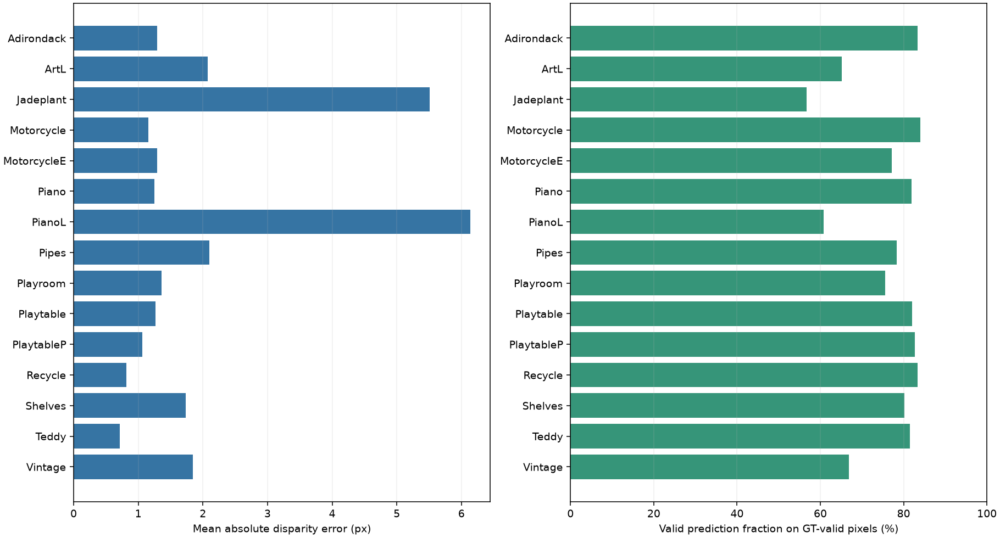
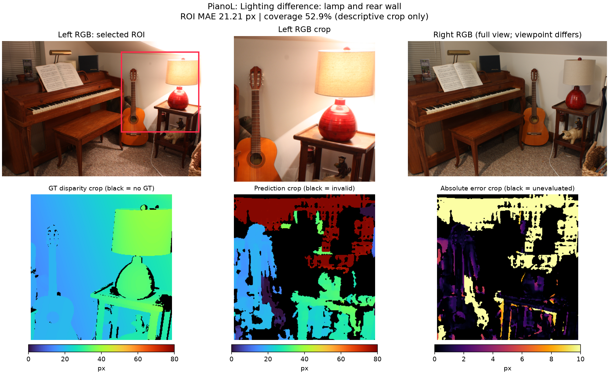
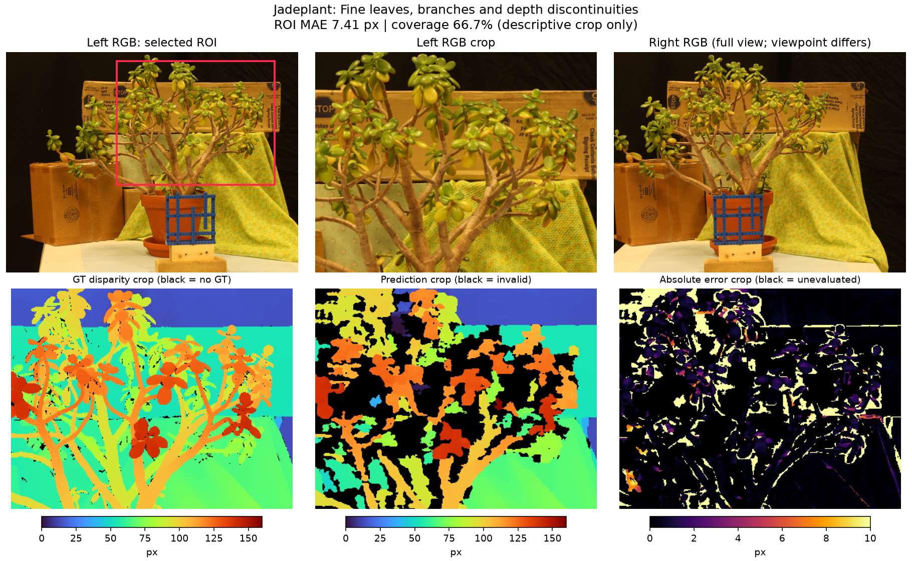
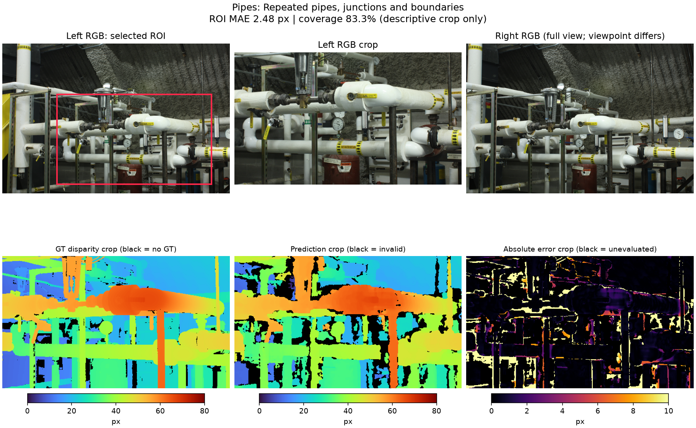

# Part 1 双目实验：结果与分析

本页图片随仓库提交，可在 GitHub 直接查看。

完成日期：2026-11-09。范围：向晨蕊负责的 Classical Stereo。当前最终实验目录为 `results/sgbm_final/`。

## 1. 已完成的内容

| 课程任务 | 实现与证据 |
| --- | --- |
| Middlebury 15 对 quarter-resolution 图像 | `data/trainingQ/`；ZIP CRC 和文件 SHA-256 已检查 |
| StereoBM 或 StereoSGBM | 使用固定配置的 StereoSGBM，无需训练 |
| 视差及无效区域展示 | 15 组 `figures/<scene>/comparison.png`，另有单独的无效区域图 |
| 视差到米制深度 | 读取各场景标定，正确处理 `/16`、`doffs` 和毫米到米 |
| 平均绝对视差误差 | `metrics.csv`、`summary.json` 和 `REPORT.md` |
| 有效预测比例 | 与 MAE 一并报告，分母包含所有有限正真值像素 |
| 运行效率 | 单线程 CPU 时间；硬件、版本、输入大小与计时范围有记录 |
| 左右一致性（选做） | 已运行独立反向匹配并输出诊断图，不改变主评价掩码 |
| 失败案例 | 下文 3 个实际场景，附固定 ROI 放大图与局部统计 |
| 正确性验证 | 6 项测试通过；独立复算全部 15 个场景，110 张 PNG 均可解码 |

可直接打开：[完整实验报告](results/sgbm_final/REPORT.md)、[逐场景指标 CSV](results/sgbm_final/metrics.csv)、[验证记录](results/sgbm_final/verification.json)、[测试日志](results/sgbm_final/test_results.txt)。

## 2. 方法及评价口径

对于经过校正的左右图，StereoSGBM 沿同一行搜索对应位置，得到左视差 `d=x_left-x_right`。本实验使用灰度输入、5×5 匹配窗口和 SGBM 三方向模式，固定 `P1=200`、`P2=800`，所有场景使用同一组参数。只有搜索范围根据公开标定文件中的 `ndisp` 向上取整为 16 的倍数，不根据真值选择范围或调参。

OpenCV 的输出是放大 16 倍的定点视差，所以先除以 16；随后用每个场景的 quarter-resolution 标定计算：

```text
Z_m = fx_px × baseline_mm / (d_px + doffs_px) / 1000
```

不再次缩放焦距。有效的零视差在 `doffs>0` 时仍能对应有限深度。OpenCV 无效哨兵、搜索范围外的预测、非正或非有限分母被排除，无效浮点结果记为 NaN。

Middlebury 视差 PFM 的二进制数据已经以像素存储，scale 仅通过符号指示大小端，不应用其绝对值；行顺序需翻转。这与通用照片 PFM 的亮度缩放处理不同。最终代码和对应测试均已修正该细节。

真值有效区域为 `isfinite(GT) & (GT>0)`。MAE 在真值和预测均有效的交集上计算；有效预测比例以全部真值有效像素为分母。因此不能只报 MAE，而不说明丢弃了多少像素。主汇总使用每场景等权平均，另外提供像素加权结果。没有用非遮挡掩码排除遮挡，也没有用 NYU 单目评价指标替代本次视差指标。

## 3. 全部场景的结果

| 汇总方式 | 平均绝对视差误差 | 有效预测比例 |
| --- | ---: | ---: |
| 每场景等权（macro，主结果） | **1.9743 px** | **75.98%** |
| 全部有效像素加权（pooled） | **1.8390 px** | **76.43%** |

共有 4,586,010 个真值有效像素，其中 3,505,282 个获得有效预测。完整的 15 场景结果见自动报告与 CSV。



这些结果支持“传统双目算法可以恢复主要场景结构，但遇到光照差异、细结构和深度边界会出现错误或空洞”。它们不等于对单目模型的评价，也不代表官方 Middlebury 排名或完整的米制深度精度测试。

Teddy 的 MAE 为 0.7103 px、有效比例为 81.45%；Recycle 为 0.8160 px、83.31%。相比之下，PianoL 为 6.1363 px、60.85%，Jadeplant 为 5.5125 px、56.75%，说明单一平均数会掩盖明显的场景差异。

### 覆盖率中包含的边界影响

所有预测的左侧都有一条明显无效带，它与实现的完整视差搜索范围有关，不应全部解释为低纹理或遮挡导致的失败。例如 Jadeplant 的搜索范围为 160 px、图宽 659 px，左侧搜索带本身约占整图宽度的 24.3%；Vintage 的范围为 192 px、图宽 722 px，约占 26.6%。这些是图像宽度比例，不等同于真值掩码上的无效像素比例。

本实验仍按课程要求将这些位置纳入有效比例的分母，没有通过裁掉边界提高覆盖率。以下诊断 ROI 均避开该左侧搜索带，便于观察图像内部的困难区域。

## 4. 三个实际困难案例

局部 ROI 是看过结果后手动固定的诊断区域，不是新测试集，也不用于调参。局部误差不能替代全场景结果或被解释为严格因果实验。完整坐标和统计保存在 `results/sgbm_final/failure_cases/roi_metrics.json`，采用 Python 的左闭右开坐标切片。

| 场景与困难区域 | 全场景 MAE / 有效比例 | ROI MAE / 有效比例 |
| --- | --- | --- |
| PianoL：台灯及后方墙面 | 6.1363 px / 60.85% | 21.2100 px / 52.94% |
| Jadeplant：密集叶片与枝条 | 5.5125 px / 56.75% | 7.4092 px / 66.75% |
| Pipes：管道交汇及边界 | 2.1039 px / 78.37% | 2.4754 px / 83.35% |

### 案例一：PianoL 的左右光照差异

左右 RGB 可见台灯及周围墙面的明显亮度差异。预测在灯罩、墙面和台灯边界处出现大片错误视差与空洞；误差图中一些区域达到或超过 10 px 的显示上限。局部有效预测的误差达到 21.21 px，说明问题不仅是像素被判为无效，也包括通过了有效性检查的严重错配。

Piano 原场景的全图误差为 1.2487 px、有效比例为 81.85%，而 PianoL 的表现明显更差。这与局部外观变化破坏匹配的现象相符；这里是数据集变体的描述性比较，没有宣称完成了严格的单因素消融。



### 案例二：Jadeplant 的叶片、枝条和遮挡边界

叶片和枝条的真值视差呈现密集的前后层次，预测在枝叶交错处出现空洞、局部形状丢失和边缘错配。放大图显示，大的背景平面较连贯，而部分枝叶轮廓不完整。

可能原因包括：5×5 窗口跨越多个深度层、细结构可用匹配支持较少，以及左右视图中的遮挡关系不同。平滑约束还可能混合前景与背景。这些是结合几何和图像观察的解释，没有单独量化每个因素的贡献。



### 案例三：Pipes 的重复结构与深度不连续

大面积管道与背景的深度关系能够恢复，但管道交汇、细杆和前后物体边界附近可见空洞与较高误差。误差分布并不是整幅图均匀变差，而是较集中在复杂结构和边界处。

重复外观可能增加对应位置的歧义；窗口跨越前后景、遮挡与边界平滑也可能造成错误。这里不能仅凭画面就将误差归因于反光或某一具体材料，因而保留为重复结构与边界的综合困难案例。



## 5. 左右一致性与运行效率

额外 LR 检查使用反向的负视差，在 `xR=round(xL-dL)` 处检查 `abs(dL+dR)<=1 px`。绿色表示通过，红色表示不通过，黑色表示没有可用的检查，不代表通过。PianoL 的已检查像素中约 9.11% 不通过，Jadeplant 约 6.47%，Pipes 约 3.24%。这些比例的分母只包含可检查位置，不能与全图无效率混为一谈；通过 LR 也不保证匹配正确。

最终实验使用 Windows 11、AMD64 CPU、16 个逻辑核心，明确将 OpenCV 限为单线程。Python 3.13.13、OpenCV 5.0.0、NumPy 2.4.6。输入为各场景原生 quarter-resolution，尺寸逐项写入 CSV 和报告。

- 左匹配：每场景预热 1 次，再计时 3 次取中位数；15 场景均值为 **35.66 ms/对**。
- 左匹配、有效性检查与米制深度换算：另测一次，15 场景均值为 **42.05 ms/对**。
- 上述时间不包含读写、绘图和额外反向 LR 匹配，不是完整程序的端到端延迟。
- CPU 实现不使用 GPU；峰值 GPU 显存为 N/A。没有把推算的纯计算吞吐量当作端到端视频帧率。

## 6. 验证与复现

6 项测试覆盖真实 SGBM 对已知 8 px 平面位移的恢复、定点缩放和无效哨兵、米制单位与 doffs、MAE 与覆盖率的不同分母、左右视差符号和出界，以及含非单位 scale 的 PFM 大小端与行顺序。

此外，`verify_results.py` 不调用主程序的评价函数，而使用独立的 `struct` PFM 读取器，对全部 15 个场景重新计算指标、验证保存深度与几何公式、核对掩码和 NaN、比对 CSV/JSON 汇总及代码/输入校验值。所有检查已通过，110 张输出 PNG 全部成功解码。三组完整困难场景图及局部图已做视觉检查。

重新生成整套结果：

```powershell
./run_all.ps1
```

只核验现有最终结果：

```powershell
python verify_results.py --output results/sgbm_final
```

`results/_invalid_pfm_scale/` 保留的是早期调试记录，已放置醒目的无效标记，不能引用其中的旧指标或图像。最终引用路径统一为 `results/sgbm_final/`。

## 7. 与组员衔接

本人的 Part 1 双目任务已完成，可以将方法、CSV 指标和三张案例图整合进小组报告。与组员的逐帧单目视频基线合并后，才构成完整的小组 Part 1；本目录没有替代组员的视频实验。NYU 的单图 metric-depth 模型复现属于本人的 Part 2，不属于这里的双目完成范围。

可用于英文报告的简短结果描述：

> We evaluated a fixed OpenCV StereoSGBM baseline on all 15 quarter-resolution Middlebury training pairs. The equal-scene mean absolute disparity error was 1.9743 pixels, with 75.98% valid predictions on finite positive ground-truth pixels. Errors were computed only where predictions were valid, so we report coverage alongside accuracy. The baseline recovered the main scene layout but exhibited missing or incorrect disparities under lighting differences, around fine leaves and branches, and near repeated pipe structures and depth discontinuities. Metric depth was obtained using each scene's calibration without fitting scale to ground truth.
