# Part 1 - Classical Stereo: experiment results

Figures are tracked as PNG files and displayed directly on GitHub. Embedded HTML can be generated locally.

UTC timestamp: 2026-11-09T14:58:17.096156+00:00

This is the stereo member's Part 1 deliverable. The frame-wise monocular/video baseline belongs to the other member.

## Protocol

15 Middlebury trainingQ pairs at native quarter resolution; left-view disp0GT.pfm. No rescaling, no training and no GT-based parameter tuning. Each scene uses the same SGBM settings; search range is the public calib.txt ndisp rounded up to a multiple of 16.

Middlebury PFM float payloads are already pixel disparities: the header scale sign selects endianness; its magnitude is not applied. Rows are read bottom-up.

OpenCV fixed-point disparity is divided by 16. An invalid prediction is a sentinel value, a disparity outside the configured search interval, or a nonpositive/nonfinite (d + doffs). Zero disparity may remain valid when doffs > 0. Invalid floating-point outputs are NaN.

Ground-truth mask: isfinite(GT) & (GT > 0). Coverage denominator is all GT-valid pixels. MAE is measured on their intersection with valid predictions; no-GT or invalid-prediction pixels do not contribute to MAE. Therefore MAE must be read together with coverage. The non-occlusion mask is not used, so this is an all-GT-valid-pixel course exercise, not an official benchmark score.

Depth in meters: Z = fx * baseline_mm / (disparity_px + doffs_px) / 1000. Use each scene's quarter-resolution calibration without scaling focal length again.

Optional LR diagnostics do not change the primary predictions or metric mask. The reverse matcher has a negative disparity interval; residual is |dL + dR| at nearest-neighbor xR = round(xL - dL). Black in the LR map means unchecked, not consistent.

## Results

- Equal-scene (macro) MAE: **1.9743 px**.
- Equal-scene valid fraction: **75.98%**.
- Pixel-pooled MAE: **1.8390 px**.
- Pixel-pooled valid fraction: **76.43%**.
- Mean left-matcher inference time: **35.66 ms/pair**.

| Scene | Size (W x H) | Search disparities | MAE (px) | Valid (%) | Inference (ms) |
| --- | --- | ---: | ---: | ---: | ---: |
| Adirondack | 718 x 496 | 80 | 1.2951 | 83.30 | 36.32 |
| ArtL | 347 x 277 | 64 | 2.0756 | 65.09 | 10.49 |
| Jadeplant | 659 x 497 | 160 | 5.5125 | 56.75 | 45.12 |
| Motorcycle | 741 x 497 | 80 | 1.1584 | 84.06 | 48.02 |
| MotorcycleE | 741 x 497 | 80 | 1.2888 | 77.21 | 36.73 |
| Piano | 707 x 481 | 80 | 1.2487 | 81.85 | 34.58 |
| PianoL | 707 x 481 | 80 | 6.1363 | 60.85 | 33.28 |
| Pipes | 735 x 485 | 80 | 2.1039 | 78.37 | 37.70 |
| Playroom | 699 x 476 | 96 | 1.3601 | 75.61 | 36.69 |
| Playtable | 680 x 463 | 80 | 1.2706 | 82.09 | 31.05 |
| PlaytableP | 681 x 462 | 80 | 1.0628 | 82.73 | 42.95 |
| Recycle | 720 x 486 | 80 | 0.8160 | 83.31 | 34.22 |
| Shelves | 738 x 497 | 64 | 1.7311 | 80.15 | 39.31 |
| Teddy | 450 x 375 | 64 | 0.7103 | 81.45 | 14.59 |
| Vintage | 722 x 480 | 192 | 1.8448 | 66.88 | 53.82 |

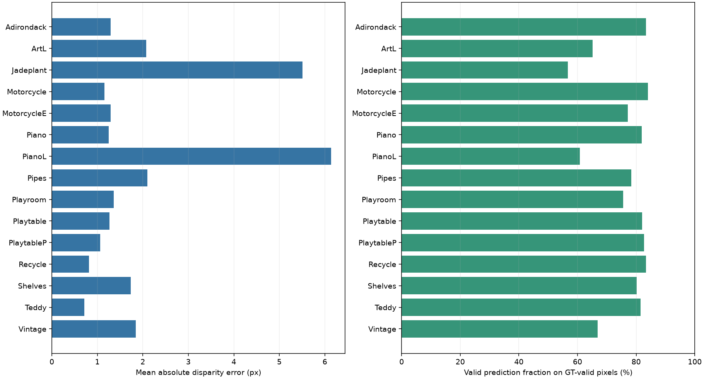

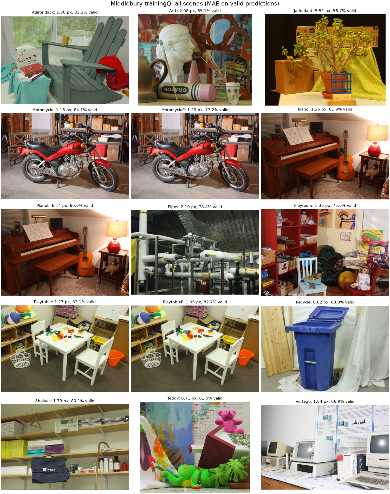

## Efficiency and reproducibility

Inference time is the median of timed left matcher.compute calls after one untimed warm-up per scene. Input decoding, grayscale conversion, allocation, right matching, visualization and saving are excluded. pipeline_ms is one warm-run of left matching plus validity and depth conversion on predecoded grayscale input; it also excludes I/O and optional LR. These are CPU measurements, not GPU FPS.

```json
{
  "platform": "Windows-11-10.0.26200-SP0",
  "cpu": "AMD64 Family 25 Model 117 Stepping 2, AuthenticAMD",
  "logical_cpus": 16,
  "python": "3.13.13",
  "opencv": "5.0.0",
  "numpy": "2.4.6",
  "matplotlib": "3.11.0",
  "backend": "OpenCV CPU",
  "precision": "uint8 grayscale input; int16 fixed-point output; float32 stored maps",
  "gpu_peak_memory": "N/A: CPU-only stereo, no GPU inference",
  "opencv_threads": 1
}
```

Exact settings, source hashes, command, input-file hashes, timing samples and units are in run.json and scene_metrics.json. Dataset archive hashes are in data/manifest.json. No claims of metric-depth accuracy are made from the disparity exercise alone.

## Per-scene comparisons

### Adirondack

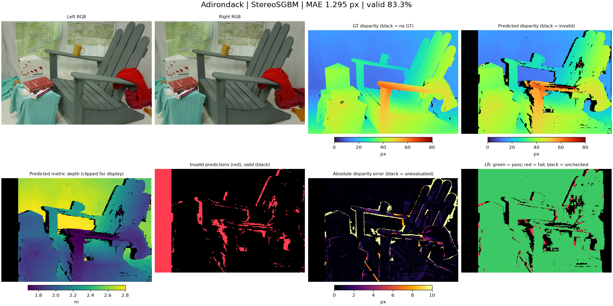

### ArtL

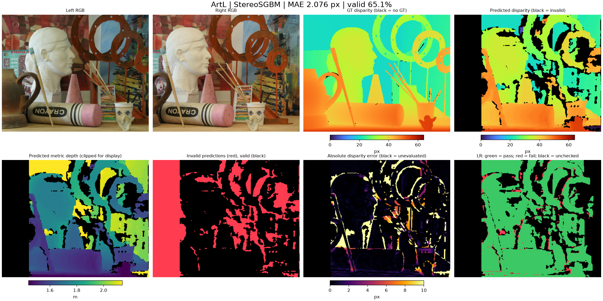

### Jadeplant

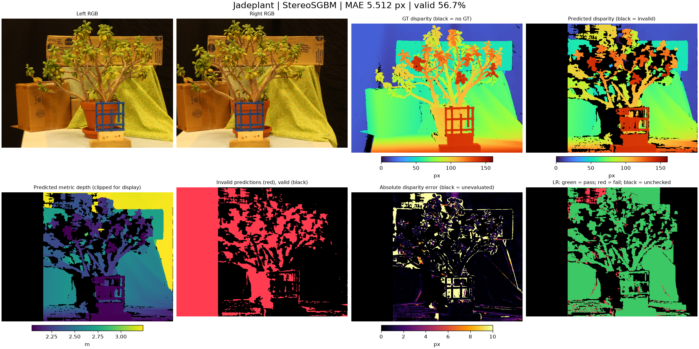

### Motorcycle

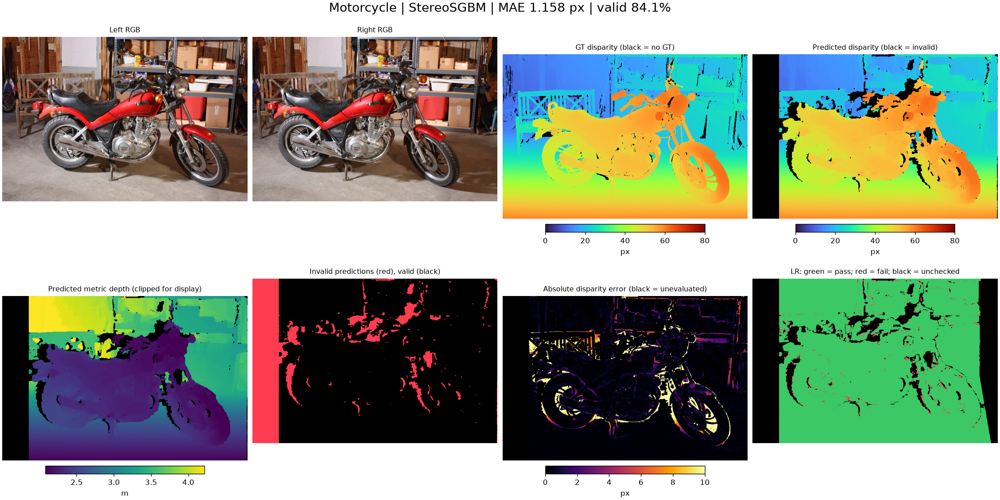

### MotorcycleE

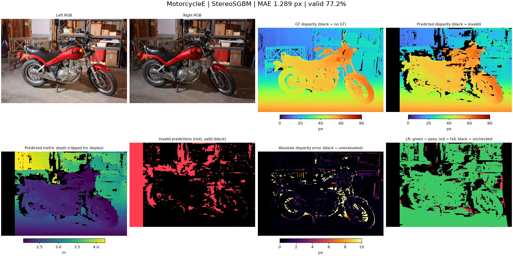

### Piano

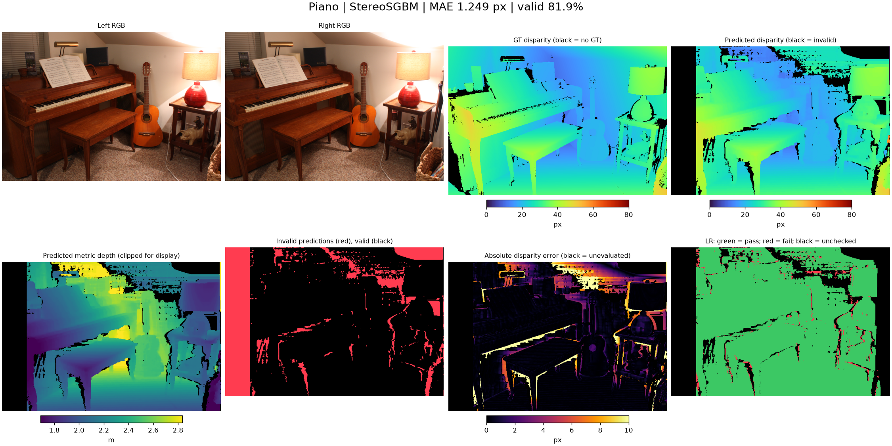

### PianoL

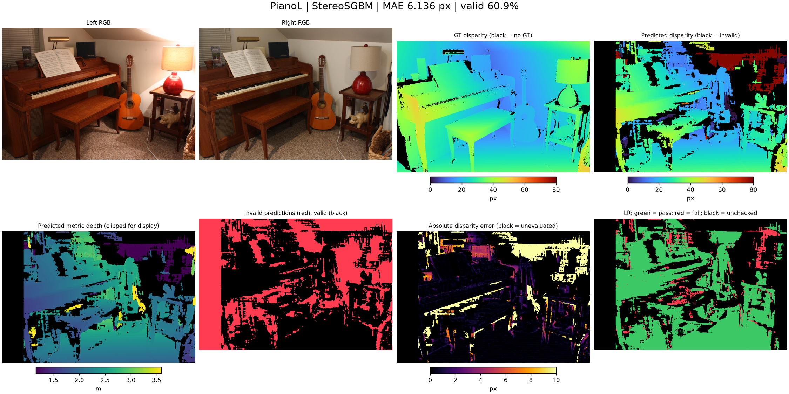

### Pipes

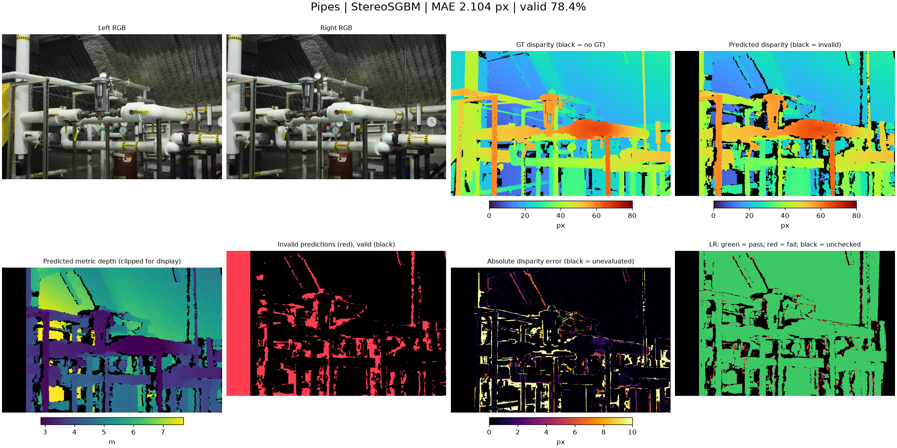

### Playroom

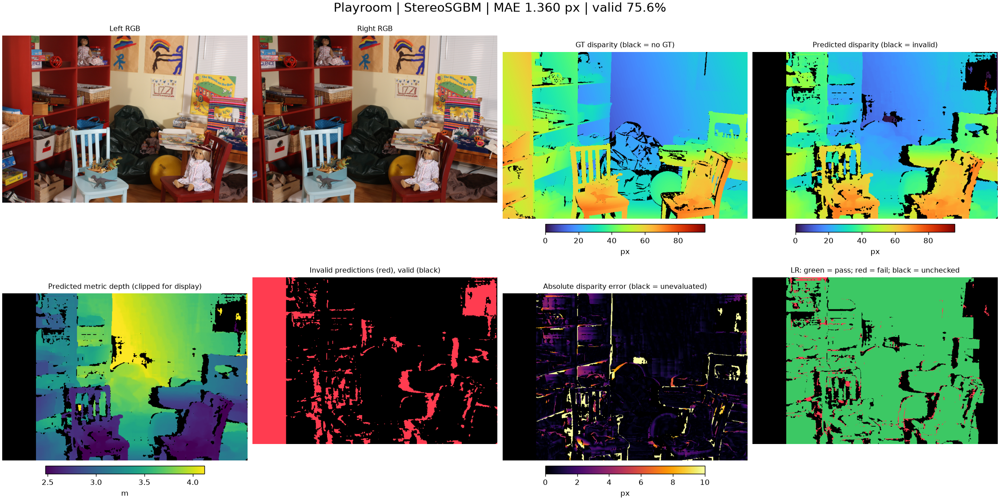

### Playtable

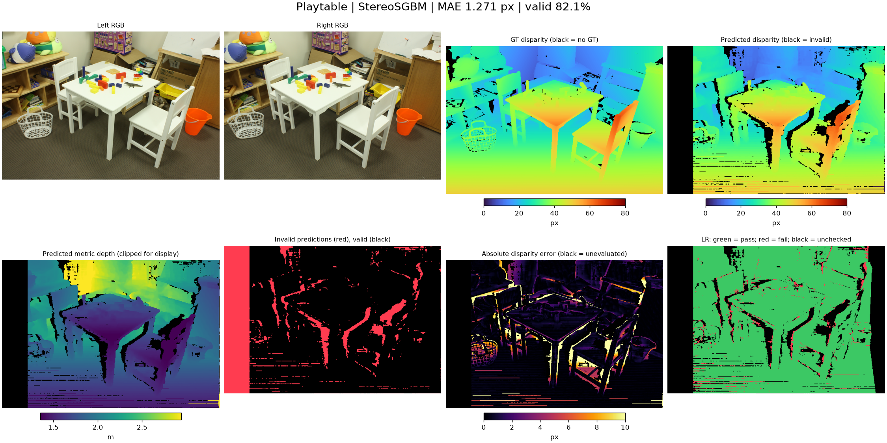

### PlaytableP

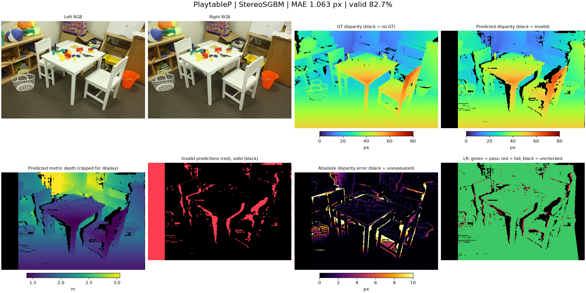

### Recycle

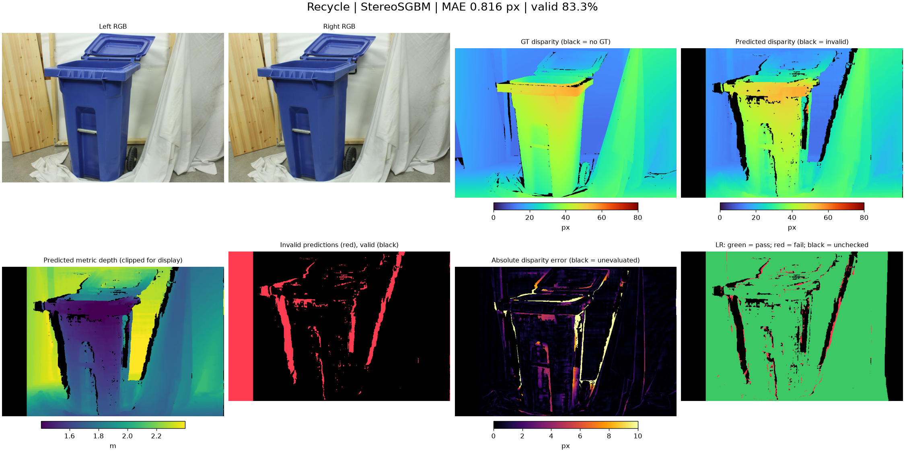

### Shelves

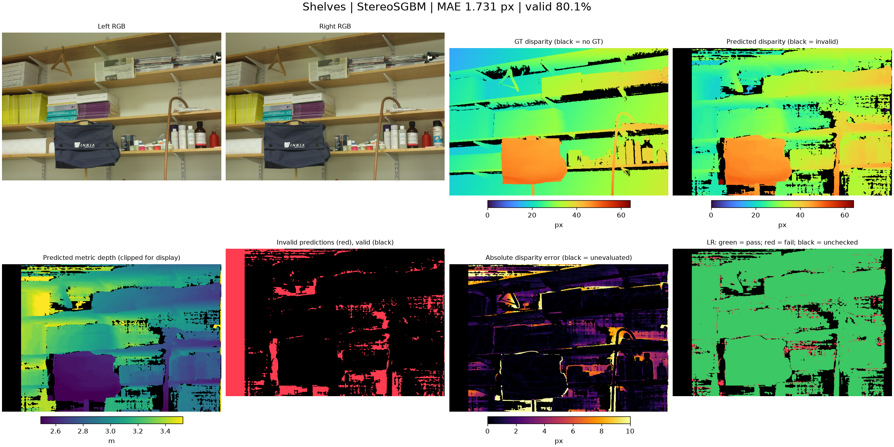

### Teddy

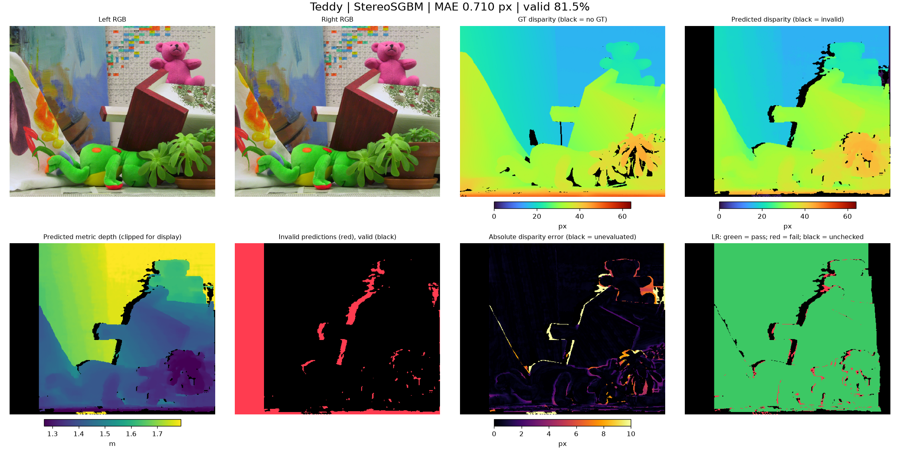

### Vintage

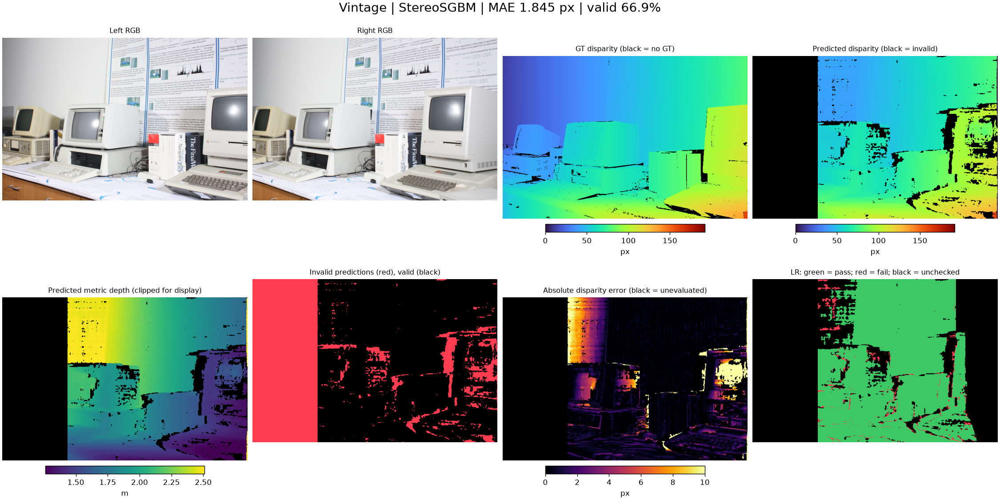
