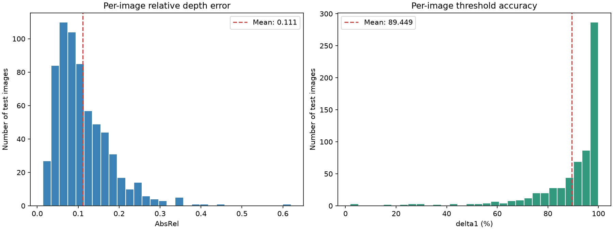
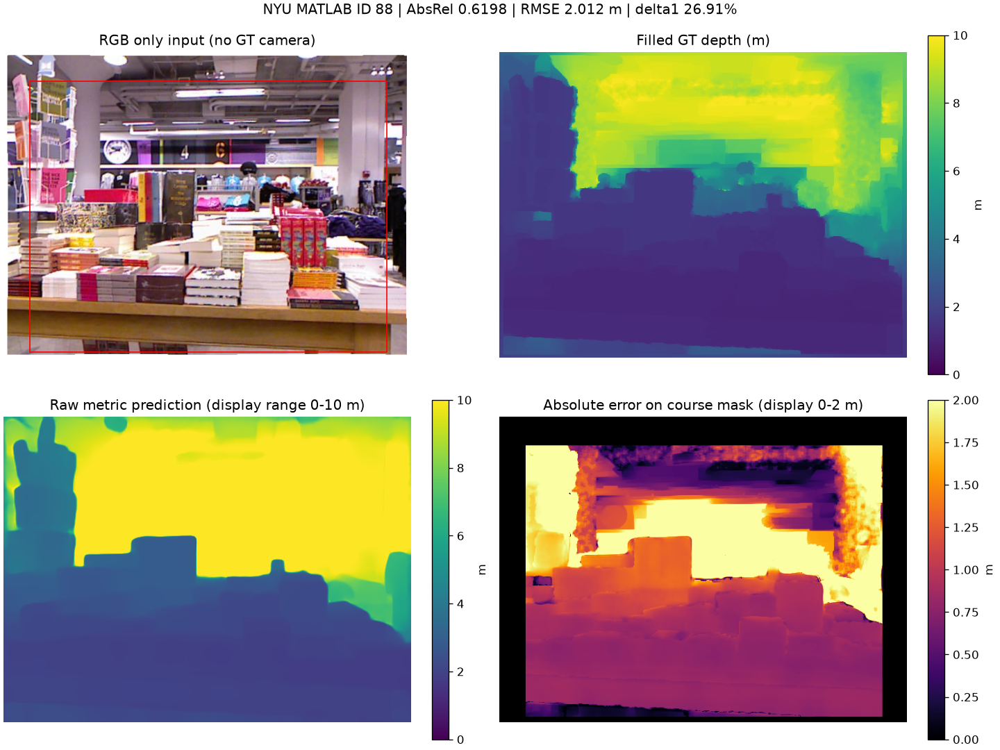
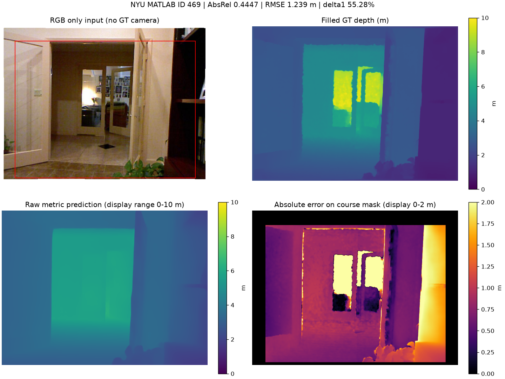
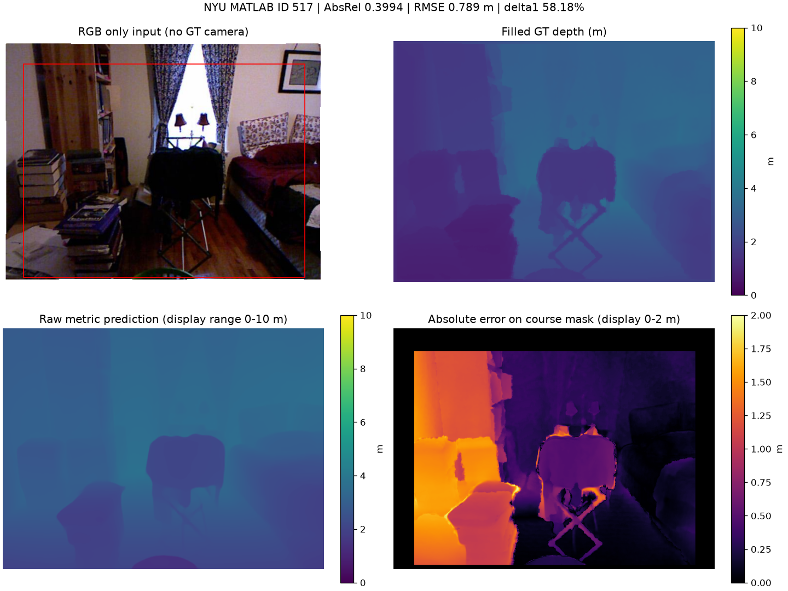

# Part 2 单图度量深度：结果与讨论

图片预览请打开 [ANALYSIS.html](ANALYSIS.md)。完整英文报告见 [REPORT.html](results/nyu_test_vits/REPORT.md)。

## 完成情况

**已完成你负责的单图度量深度 Part 2。** 官方 UniDepthV2 ViT-S 已在 NYU 官方 654 张测试图像上完整运行。仅输入 RGB，没有训练或微调，没有传入真值内参，也没有在测试集拟合尺度。视频深度属于组员负责的另一分支。

## 正式结果

| 指标 | 654 张逐图等权平均 | 含义 |
| --- | ---: | --- |
| AbsRel ↓ | **0.110923** | 绝对深度误差除以真实深度，再求平均 |
| RMSE ↓ | **0.393103 m** | 每张图的深度均方根误差，再逐图平均 |
| δ1 ↑ | **89.4488%** | 预测/真值的双向比值小于 1.25 的像素比例，再逐图平均 |

AbsRel 的逐图中位数为 0.095453。平均值与中位数不同，体现困难图像对整体平均值的影响。AbsRel 并非米或厘米；δ1 也不是“所有像素的深度完全准确”。

## 评价设置与实际资源

训练/开发集 795 张与测试集 654 张分离；使用 labeled 文件中的 filled depths（米），不是 rawDepths。输出 480×640，Python 裁剪 [45:471,41:601]，真值限制为 0.001 到 10 米之间。预测仅在评价时裁剪至 [0.001,10]；保存的 NPY 为未经尺度对齐的原始 float32 米制深度。AbsRel、RMSE、δ1 均逐图计算后等权平均，没有把像素拼接后进行加权平均。

官方模型 resolution_level=0，实测编码器输入 434×574。该分辨率档位是官方支持的推理选项，不是与论文所有分辨率/设置完全相同的复现，因此这些分数不能直接声称重现论文表格。

本机 CPU FP32、8 线程；平均推理 **1119.36 ms/张**，中位数 **1078.85 ms/张**。计时包括官方 infer 的预处理、模型计算与尺寸恢复，不包括读文件、指标计算、保存和绘图，已排除一次预热。CPU 没有峰值 GPU 显存，记为 N/A。运行中记录到的最大进程 RSS 为 832.8 MiB，它不是 GPU 显存，也不是严格的全生命周期峰值内存。

## 三个实际困难案例

以下为 AbsRel 最高的三张测试图。场景名来自 NYU 元数据。预测/真值的中位数比值只用于事后描述偏差，**没有拿这个比值调整预测**。同一场景的相邻视角可能同时进入前三，它们是三个困难图像案例，不应声称是三个独立场景类别。

| MATLAB ID | 场景 | AbsRel | RMSE (m) | δ1 | 原始预测/真值中位数 |
| ---: | --- | ---: | ---: | ---: | ---: |
| 88 | bookstore_0001 | 0.6198 | 2.0117 | 26.91% | 1.699 |
| 469 | study_0001 | 0.4447 | 1.2392 | 55.28% | 1.231 |
| 517 | bedroom_0133 | 0.3994 | 0.7895 | 58.18% | 1.108 |

### 图像 88：bookstore_0001

原始预测/真值的中位数为 1.699，说明该图像的距离估计偏大。这只是对该图的描述，不能据此给全部测试图选择一个校准倍率。

RGB 中是书店的桌面、书堆和后方空间。预测仍保留了部分前后层次，但桌面、书堆与背景的距离整体偏大，远处部分区域达到 10 米的显示上限。误差覆盖较大片区域，说明局限不仅是边缘不够清楚，还包含绝对尺度偏差。这里没有用该图的真值对预测进行尺度校准。

### 图像 469：study_0001

原始预测/真值的中位数为 1.231，说明该图像的距离估计偏大。这只是对该图的描述，不能据此给全部测试图选择一个校准倍率。

RGB 中可见门框、书柜以及两块带反射内容的镜面外观区域。给定真值在反射区域内部显示出明显更大的深度，而预测将该区域处理得更接近平滑平面，内部和周围边界存在较大误差。镜面会使视觉线索与深度传感器测量的解释更复杂；本实验只报告与给定 filled GT 的差异，没有单独验证材质，也未将模型误差与真值误差分离。

### 图像 517：bedroom_0133

原始预测/真值的中位数为 1.108，说明该图像的距离估计偏大。这只是对该图的描述，不能据此给全部测试图选择一个校准倍率。

RGB 中是书堆、书架、椅子、床和明亮窗户。预测保留了椅子的大致轮廓与主要前后关系，但左侧近处书堆、书架和椅子边缘出现明显深度偏差。图像同时包含明亮窗户和暗色前景，但单个案例不足以证明曝光差异是唯一原因；这里将其作为近处杂物、边界和局部距离错误的综合案例。

## 如何判断结果

已经建立了可复现、无测试尺度拟合的 metric-depth baseline，并量化了绝对距离误差。结果包含全量测试、逐图误差和真实困难案例，可以用于课程进度展示及后续改进对照。没有相同环境下的其他模型/设置对照，不能仅凭单一分数宣称达到 SOTA，也不能把 Part 1 的视差像素误差与这里的米制误差直接比较。

## 与 Part 3 的关系

原始预测已固定保存，之后可在相同测试协议下评估改进。若选择全局尺度校准，必须先在 795 张训练/开发图上拟合、固定，再用于测试集；不能用本次测试案例的真值拟合倍率，也不能挑一个让测试分数最好看的倍率。边界细化也需固定设置后与此 baseline 对比。当前没有提前混入任何 Part 3 改进。

## 文件入口

- [运行与复现说明](README.md)
- [完整图片内嵌报告](results/nyu_test_vits/REPORT.md)
- [654 张逐图指标](results/nyu_test_vits/metrics.csv)
- [独立核验记录](results/nyu_test_vits/verification.json)
- [9 项协议测试日志](logs/protocol_tests.txt)