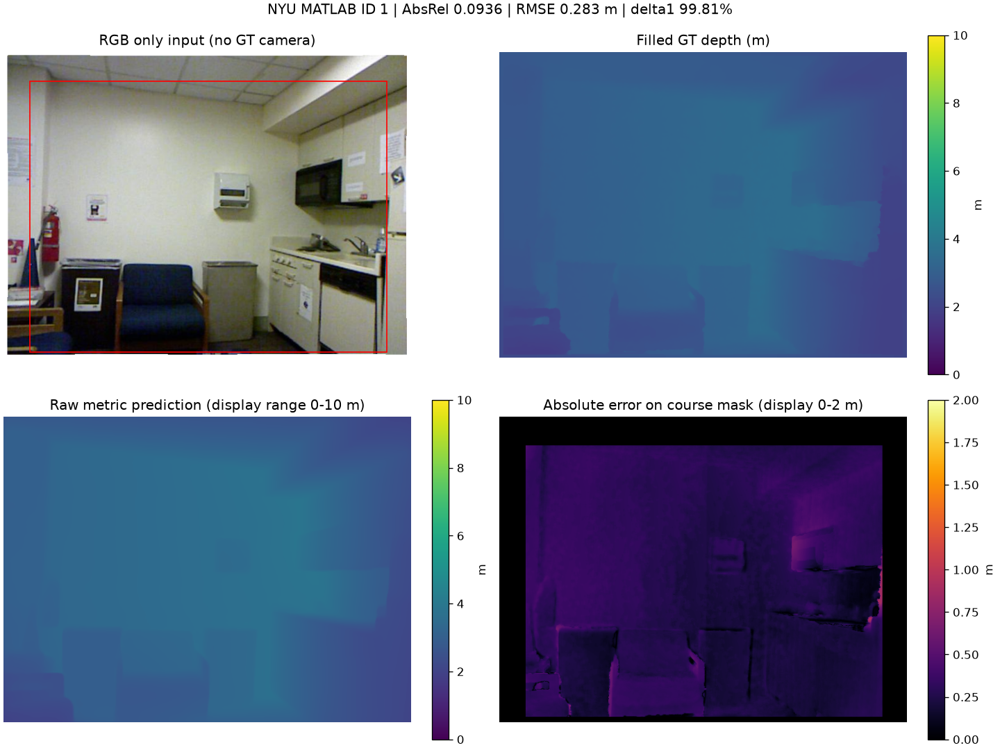
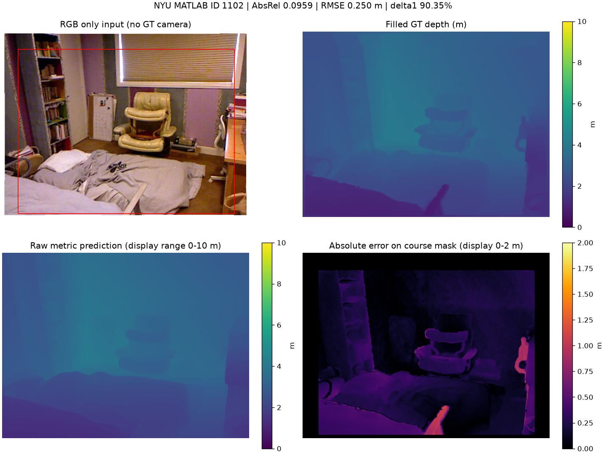
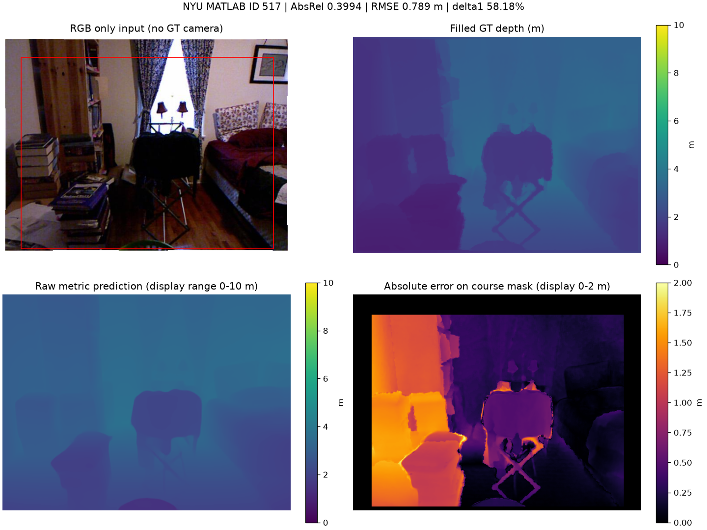
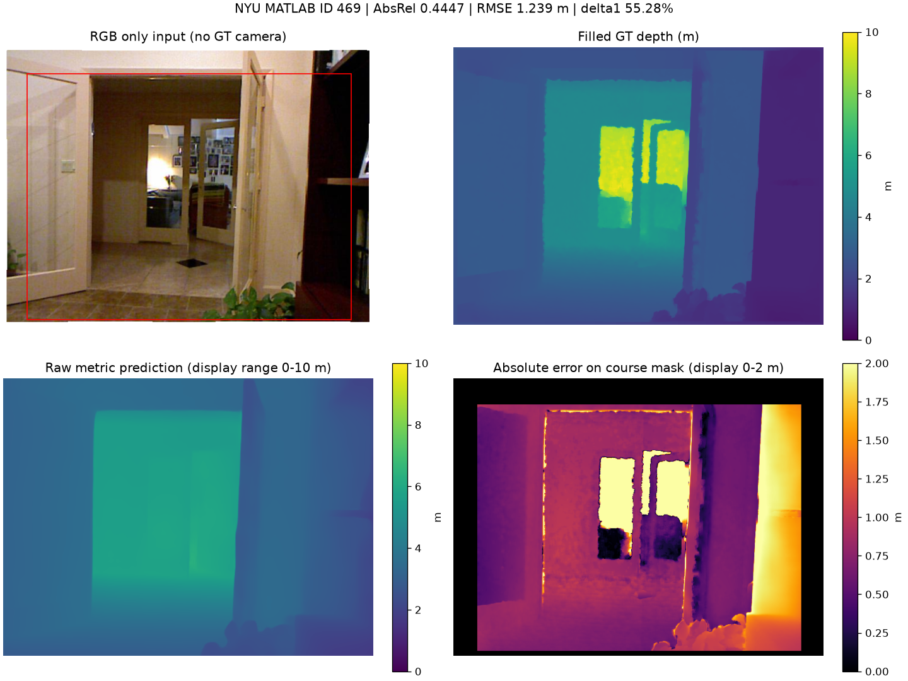
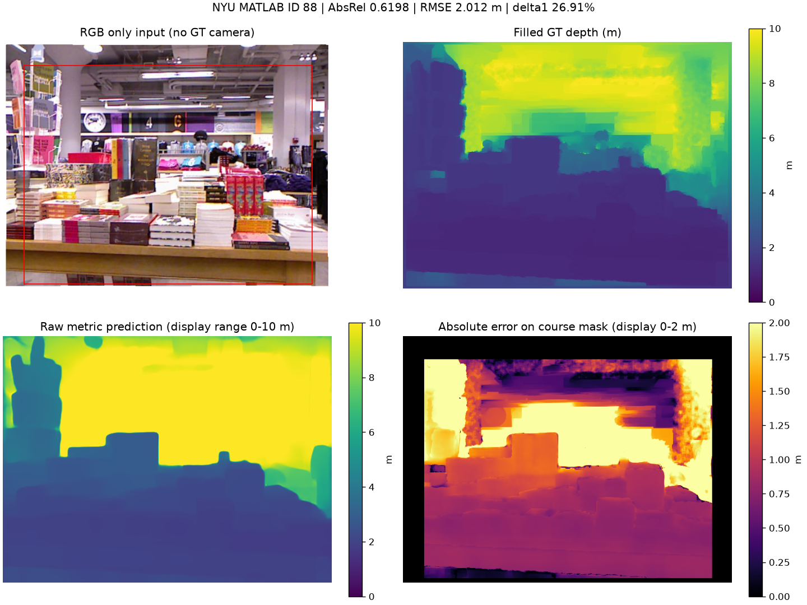

# Part 2: UniDepthV2 ViT-S / NYU course evaluation

Status: **complete**, 654/654 images (test).

| AbsRel (lower) | RMSE, m (lower) | delta1 (higher) | Mean inference, ms |
| ---: | ---: | ---: | ---: |
| 0.110923 | 0.393103 | 89.4488% | 1119.36 |

## Evaluation protocol

Official split: train/development 795 images; test 654 images. MATLAB IDs are converted to zero-based IDs once. RGB = images[i].transpose(2,1,0); filled depth in meters = depths[i].T. rawDepths is not used. No GT intrinsics, GT depths or scale calibration are passed to the model.

Predictions are resized to 480x640 (bilinear if necessary). Python crop [45:471,41:601]. GT mask: finite, >0.001 and <10 m. Predictions clipped to [0.001,10] for metrics only; raw floating-point depth is saved unchanged. AbsRel, RMSE and delta1 (strict ratio <1.25) are computed per image and then averaged equally. No median alignment, scale fitting or per-image normalization. A partial run is not the final 654-image result.

## Model and efficiency

Exact official architecture and checkpoint. infer(uint8 CHW RGB) performs official normalization, padding and resizing. Resolution level uses the upstream supported setting and is fixed for the run. Inference includes model preprocessing/forward/postprocessing, excludes data reading, metric calculation, disk writing and plotting. One warm-up on the first input is excluded. CPU peak GPU memory is N/A; CPU RSS is reported separately. GPU measurements, if used, synchronize CUDA and include peak allocated memory, not the caching allocator reserve.

```json
{
  "model": "UniDepthV2 ViT-S",
  "device": "cpu",
  "torch": "2.14.1+cpu",
  "precision": "CPU FP32",
  "threads": 8,
  "resolution_level": 0,
  "parameters": 34184323,
  "checkpoint_load": "official from_pretrained(local directory), strict=True",
  "RGB_only": true,
  "preprocessing": "Official model.infer(uint8 CHW RGB); normalize/pad/resize internally",
  "hardware": "AMD64 Family 25 Model 117 Stepping 2, AuthenticAMD",
  "encoder_shape": [
    1,
    3,
    434,
    574
  ]
}
```

The run records checkpoint revision/hash, upstream commit, input assets, source hashes and per-image timings. Course scores are not claimed to exactly reproduce a paper table because protocols may differ.

## Representative and difficult cases

The figures show the first input, median case and three largest AbsRel cases, without tuning the model on these cases. Depth color limits are fixed to 0-10 m for both GT and prediction; error is displayed at 0-2 m. Saturated color does not mean the underlying value has been truncated in the saved prediction.

### MATLAB ID 1: AbsRel 0.0936



### MATLAB ID 1102: AbsRel 0.0959



### MATLAB ID 517: AbsRel 0.3994



### MATLAB ID 469: AbsRel 0.4447



### MATLAB ID 88: AbsRel 0.6198



## Sources

- UniDepthV2: https://github.com/lpiccinelli-eth/UniDepth
- Official ViT-S checkpoint: https://huggingface.co/lpiccinelli/unidepth-v2-vits14
- NYU labeled dataset and official splits: URLs/hashes in data/asset_manifest.json.
- Course Project 3 PDF, sections 5.2 and 6.2.